# Airbnb Listing Experience — High-Fidelity Desktop Recreation

A high-fidelity recreation of a modern Airbnb property listing experience, built from visual reference screenshots with a focus on frontend engineering, interaction parity, accessibility, and a structured AI-assisted development workflow.

[](https://react.dev/)
[](https://vitejs.dev/)
[](https://developer.mozilla.org/en-US/docs/Web/JavaScript)
[](https://developer.mozilla.org/en-US/docs/Web/CSS)
[](https://lucide.dev/)
[-brightgreen)](https://oxc.rs/)

**Frontend Engineering** &nbsp;|&nbsp; **Desktop Fidelity (1890×870)** &nbsp;|&nbsp; **Interaction Parity** &nbsp;|&nbsp; **WCAG 2.1 AA a11y** &nbsp;|&nbsp; **AI-Assisted Workflow**

---

## 📌 Repository & Evaluation Overview

- **GitHub Repository**: [https://github.com/Shreyans-704/Airbnb-Clone-](https://github.com/Shreyans-704/Airbnb-Clone-)
- **Live Link**: https://airbnb-clone-gilt-seven.vercel.app/
- **Application Directory**: [`airbnb-listing/`](airbnb-listing/)
- **Evaluation Viewport**: `1890 × 870 px` (Standardized Desktop Viewport)
- **Scope**: Frontend-only single-page vacation-rental listing.

> [!NOTE]
> **Independent Recreation**: This project is an independent technical submission created for a frontend take-home assignment. It is built strictly from visual reference material. It is **not** an official Airbnb product, is not affiliated with Airbnb, Inc., and does not claim backend services.

---

## 🎯 Executive Summary

This project recreates the complete desktop vacation-rental property listing experience for **Romantic Jacuzzi 1BHK Candolim | Mirashya UG10**. Built with **React 19**, **Vite 8**, and **Pure CSS Design Tokens**, static visual reference material is translated into a modular, responsive, and accessible frontend application.

### Key Engineering Highlights
1. **High Visual Fidelity**: Faithful desktop translation (spacing rhythm, typography hierarchy, responsive column proportions, and design tokens) calibrated against reference captures at `1890 × 870 px`.
2. **Behavioral Parity**: Sticky booking sidebar, dynamically engaged in-page navigation with native `IntersectionObserver` scroll spy, 2-month interactive date picker, guest count stepper, categorized photo tour, and fullscreen lightbox.
3. **Accessibility (WCAG 2.1 AA)**: Full keyboard navigability, focus trapping inside dialogs, focus restoration on close (`preventScroll: true`), Escape-to-close with propagation guards, and reference-counted body scroll locking for stacked modals.
4. **AI-Assisted Engineering Workflow**: Driven by structured prompts, sub-agent roles, programmatic screenshot captures via Puppeteer, and iterative QA passes rather than unguided one-shot generation.

---

## 🖼️ Interface Showcase

All screenshots below represent the actual implementation captured at `1890 × 870 px` from the [`screenshots/final/`](screenshots/final/) directory.

### 1. Listing Experience & Dynamic Navigation

<table>
  <tr>
    <td width="50%">
      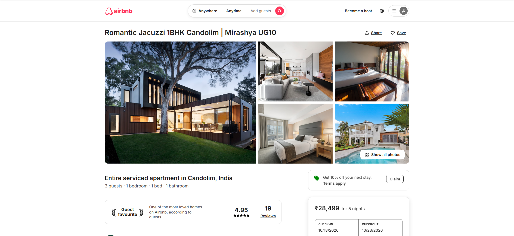
      <p align="center"><b>01. Top of Page & Hero Gallery</b><br/><i>Airbnb search pill, property header with Share/Save, and 5-photo asymmetric grid.</i></p>
    </td>
    <td width="50%">
      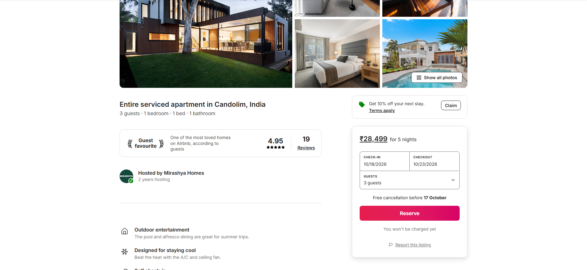
      <p align="center"><b>02. Listing Overview & Host Summary</b><br/><i>SVG laurel Guest Favourite badge, host credentials, highlights, and sticky sidebar.</i></p>
    </td>
  </tr>
  <tr>
    <td width="50%">
      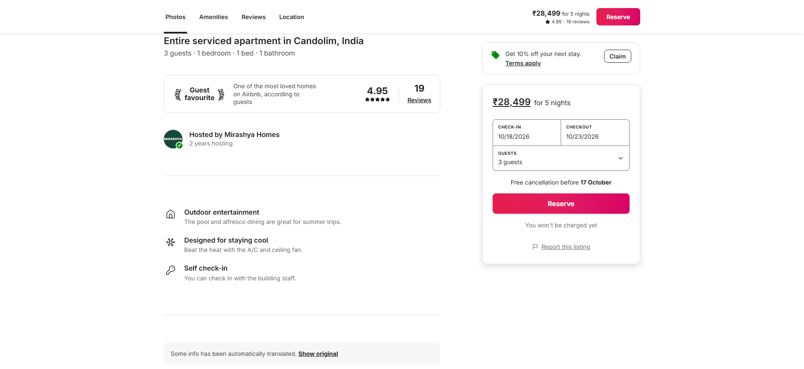
      <p align="center"><b>03. In-Page Sticky Navigation</b><br/><i>Engages past hero gallery (scrollY &gt; 420px) with scroll spy tabs and reservation CTA.</i></p>
    </td>
    <td width="50%">
      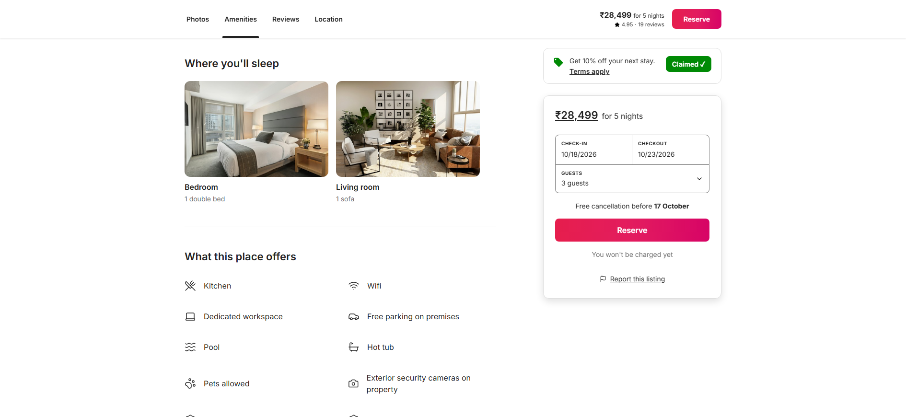
      <p align="center"><b>04. Sleeping Arrangements & Amenities</b><br/><i>Room cards with photography and 2-column preview of 10 key amenities.</i></p>
    </td>
  </tr>
</table>

### 2. Verified Reviews, Vector Coastline Map & Stays Nearby

<table>
  <tr>
    <td width="50%">
      
      <p align="center"><b>05. Verified Reviews Breakdown</b><br/><i>Overall 4.95 score, 6-category rating progress bars, and 2-column guest reviews.</i></p>
    </td>
    <td width="50%">
      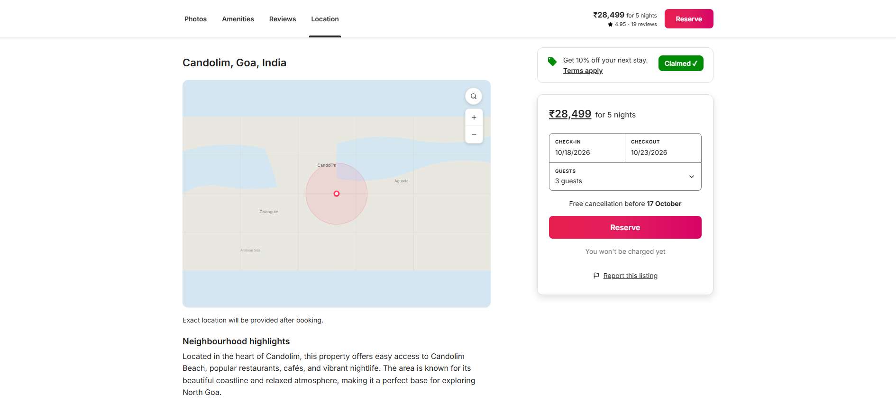
      <p align="center"><b>06. Location & Coastline Vector Map</b><br/><i>Hand-crafted SVG map of Candolim beach coast with proximity circle and pin.</i></p>
    </td>
  </tr>
  <tr>
    <td width="50%">
      
      <p align="center"><b>07. Host Credibility Profile</b><br/><i>Superhost statistics (1,463 reviews, 4.68 rating), co-host roster, and messaging button.</i></p>
    </td>
    <td width="50%">
      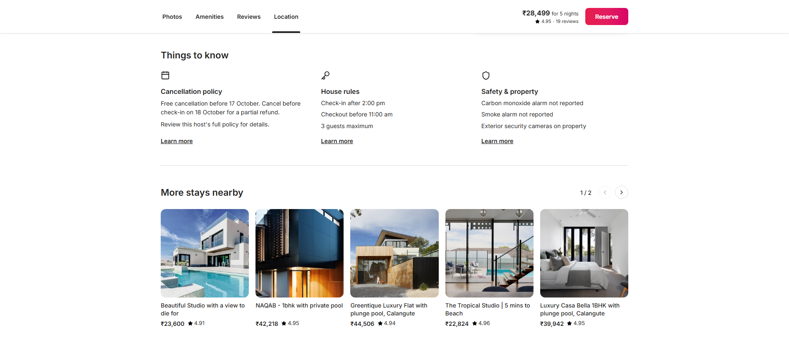
      <p align="center"><b>08. Policies & Stays Nearby Carousel</b><br/><i>3-column Things to Know and 5-card horizontal carousel with pagination controls.</i></p>
    </td>
  </tr>
</table>

### 3. Interactive Overlays & Global Footer

<table>
  <tr>
    <td width="33%">
      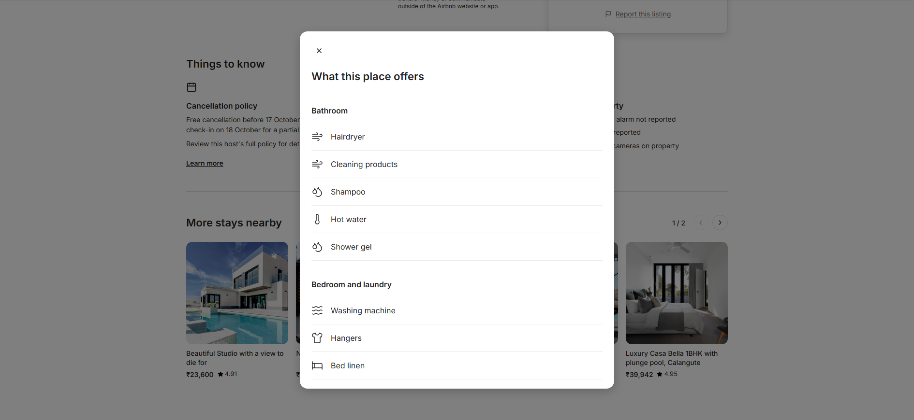
      <p align="center"><b>09. Categorized Amenities Dialog</b><br/><i>Grouped amenities with strikethroughs, focus trap, and Escape dismissal.</i></p>
    </td>
    <td width="33%">
      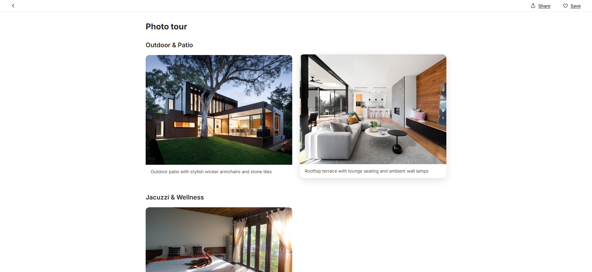
      <p align="center"><b>10. Categorized Photo Tour</b><br/><i>Full-viewport gallery grouped by space with sticky controls and scroll lock.</i></p>
    </td>
    <td width="33%">
      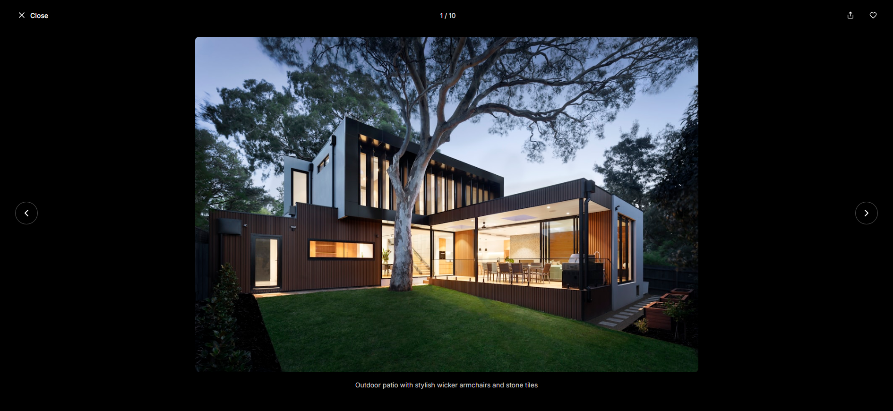
      <p align="center"><b>11. Fullscreen Lightbox</b><br/><i>Pure black backdrop, circular keyboard navigation, focus trap, and toast feedback.</i></p>
    </td>
  </tr>
  <tr>
    <td colspan="3">
      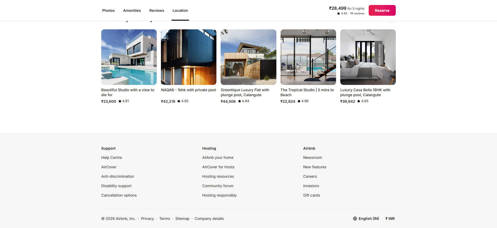
      <p align="center"><b>12. Global Footer</b><br/><i>Standard 3-column footer with localized currency (₹ INR) and language selector.</i></p>
    </td>
  </tr>
</table>

---

## 🚀 What I Built: Feature Matrix

| Area | Features Implemented | Behavioral Details |
|---|---|---|
| **Header & Search** | Global header, search pill, user menu | 4 interactive segments scroll to in-page anchors; user menu toggles dropdown with outside-click dismiss. |
| **Property Header** | Title, location breadcrumbs, actions | Interactive **Share** (copies link with toast confirmation) and **Save** (wishlist toggle). |
| **Hero Photo Gallery** | 5-photo asymmetric desktop grid | Border radii (`12px`), hover zooms; clicking any photo launches Lightbox; "Show all photos" opens Photo Tour. |
| **Guest Favourite** | SVG laurel wreath badge & ratings | Overall 4.95 rating, 5 stars, underlined review count link. |
| **Property Details** | Apartment specs, host avatar, highlights | Forest green host avatar with "MIRASHYA" brand lettering; highlights with Lucide icons; expandable description. |
| **Sleeping & Amenities** | Bedroom/Living room cards, amenities preview | Side-by-side photo cards; 2-column preview of 10 items (with struck-through alarms); "Show all 43 amenities" CTA. |
| **Interactive Calendar** | 2-month desktop calendar view | Range selection, night counter computation, in-range highlights, month navigation, and "Clear dates" action. |
| **Verified Reviews** | 6-category breakdown bars, 6 cards | Cleanliness, Accuracy, Check-in, Communication, Location, Value progress bars; 2-column testimonial cards. |
| **Location & Map** | Candolim neighborhood, vector map | Custom North Goa SVG coastline map with proximity circle, marker pin, and zoom controls. |
| **Host Profile** | Superhost credentials, co-hosts | Stats (1,463 reviews, 4.68 rating, 2 years hosting), co-host roster, and Airbnb payment protection disclaimer. |
| **Things to Know** | 3-column policy section | House rules, Safety & property details, and Cancellation policy with "Learn more" links. |
| **Nearby Stays** | 5-card horizontal carousel | Page pagination (`1 / 2`) with prev/next navigation controls. |
| **Sticky Booking Sidebar** | Sticky reservation card & coupon banner | Coupon "Claim" toggle; check-in/checkout triggers scrolling to `#calendar`; guest dropdown with +/− steppers (max 3); Reserve button with confirmation feedback. |
| **Sticky Navigation Bar** | In-page navigation bar | Slides down at `scrollY > 420px`; native `IntersectionObserver` scroll spy tracks active tab; compact Reserve button. |
| **Photo Tour Overlay** | Full-viewport categorized modal | 10 photos grouped by space, sticky sub-header with Back/Share/Save, body scroll lock, Escape dismissal. |
| **Fullscreen Lightbox** | Black backdrop (`#000000`) image viewer | Previous/Next navigation, wrap-around index (`1 / 10`), keyboard arrows, focus trap, and focus restoration. |

---

## 🛠️ Tech Stack

| Layer | Technology | Version | Rationale |
|---|---|---|---|
| **UI Framework** | [React](https://react.dev/) | `^19.2.8` | Declarative UI, component composition, modern hooks. |
| **Build Tool** | [Vite](https://vitejs.dev/) | `^8.3.0` | Sub-second HMR, optimized production bundle (837ms build). |
| **Language** | [JavaScript / JSX](https://developer.mozilla.org/en-US/docs/Web/JavaScript) | ES2023 | Standard modern JavaScript with native ES modules. |
| **Styling** | Pure CSS3 (Design Tokens) | Vanilla CSS | CSS custom properties in [`src/index.css`](airbnb-listing/src/index.css), zero runtime overhead, pixel-level styling control. |
| **Iconography** | [Lucide React](https://lucide.dev/) | `^1.46.0` | Accessible vector SVG icons matching Airbnb design language. |
| **Linter** | [Oxlint](https://oxc.rs/) | `^1.81.0` | High-speed Rust linter (0 errors / 0 warnings on 31 files in 79ms). |
| **QA Automation** | [Puppeteer Core](https://pptr.dev/) | `^25.11.0` | Programmatic Chromium screenshots at exact scroll offsets and modal states. |
| **Package Manager** | [npm](https://www.npmjs.com/) | Standard | Dependency management and script orchestration. |

---

## 🏛️ Component Architecture & Code Organization

```
airbnb-clone/
├── .ai/                                  # AI-assisted workflow documentation & QA audit logs
│   ├── agents/workflow-plan.md           # Phased agent workflow & responsibilities
│   ├── prompts/phase-0-reconnaissance.md # Archived Phase 0 reconnaissance prompt
│   └── visual-qa/                        # Section-by-section QA comparison reports
│       ├── phase-1-visual-qa.md          # Layout, sticky navigation, and styling fixes
│       ├── phase-3-visual-qa.md          # Lightbox & interaction audit report
│       └── phase-4-final-qa.md           # Final visual, behavioral & a11y sign-off
├── screenshots/final/                    # 12 verified desktop QA screenshots
├── airbnb-listing/                       # React 19 application root
│   ├── src/
│   │   ├── components/                   # 19 isolated presentational components
│   │   │   ├── Amenities/                ├── HeroGallery/           ├── PhotoTour/
│   │   │   ├── AmenitiesModal/           ├── HostSection/           ├── PropertyContent/
│   │   │   ├── BookingCard/              ├── Lightbox/              ├── PropertyHeader/
│   │   │   ├── Calendar/                 ├── LocationMap/           ├── Reviews/
│   │   │   ├── Footer/                   ├── NearbyListings/        ├── SleepingArrangements/
│   │   │   ├── GuestFavourite/           ├── Header/                ├── StickyNavigation/
│   │   │   └── ThingsToKnow/
│   │   ├── data/                         # Normalized property, reviews & gallery datasets
│   │   ├── hooks/                        # Reusable cross-cutting behavioral hooks
│   │   │   ├── useBodyScrollLock.js      # Reference-counted scroll locking for stacked modals
│   │   │   └── useScrollSpy.js           # IntersectionObserver-based active section tracker
│   │   ├── App.jsx                       # State coordination & modal orchestration
│   │   ├── App.css                       # Column grid and flex layout rules
│   │   └── index.css                     # Global design tokens & CSS reset
│   ├── capture_qa.js                     # Puppeteer screenshot capture script
│   └── package.json                      # Build scripts and dependencies
└── README.md                             # Project documentation & engineering report
```

### Architectural Principles
1. **Separation of Concerns**: Property datasets live in normalized data modules ([`src/data/`](airbnb-listing/src/data/)), keeping presentational components purely declarative.
2. **Component-Scoped Styles**: Each component is co-located with its scoped CSS file (e.g. `BookingCard.jsx` + `BookingCard.css`), consuming global design tokens from [`src/index.css`](airbnb-listing/src/index.css).
3. **Reference-Counted Body Scroll Locking ([`useBodyScrollLock.js`](airbnb-listing/src/hooks/useBodyScrollLock.js))**: Supports stacked modals (Listing &rarr; Photo Tour &rarr; Lightbox). Preserves window scroll position with `position: fixed; top: -{scrollY}px` and restores scroll only after all overlays close.
4. **Native ScrollSpy ([`useScrollSpy.js`](airbnb-listing/src/hooks/useScrollSpy.js))**: Uses `IntersectionObserver` with root margin offsets instead of high-frequency scroll event listeners, avoiding layout thrashing.

---

## 🤖 AI-Assisted Engineering Workflow

This project was built using a systematic AI-assisted engineering process consisting of structured prompts, sub-agent roles, programmatic screenshot verification, and iterative refinements:

```
[Phase 0: Reconnaissance] ──> [Phase 1: Scaffolding & Visual QA] ──> [Phase 2: Photo Tour]
             │                                   │                                 │
             ▼                                   ▼                                 ▼
   Architecture Plan                   Component Composition             Scroll Lock Handling
             │                                   │                                 │
             └───────────────────────────────────┼─────────────────────────────────┘
                                                 ▼
[Phase 3: Lightbox & a11y QA] ──> [Phase 4: Behavioral & Final QA] ──> [Ready Submission]
   Focus Trap & Restoration              Guest Stepper & Lint               0 Errors / 0 Warnings
```

| Phase | Engineering Role & Focus | Primary Deliverable | Audit Document |
|---|---|---|---|
| **Phase 0: Reconnaissance** | **Lead Frontend Engineer**<br/>Analyze reference screenshots, inspect constraints, define tech stack and state model. | Implementation plan, component hierarchy, risk analysis. | [`.ai/prompts/phase-0-reconnaissance.md`](.ai/prompts/phase-0-reconnaissance.md) |
| **Phase 1: Core Implementation** | **Frontend Engineer**<br/>Design tokens, top-to-bottom layout composition, and visual alignment. | Single-page listing with 12 sections and initial screenshot diffs. | [`.ai/visual-qa/phase-1-visual-qa.md`](.ai/visual-qa/phase-1-visual-qa.md) |
| **Phase 2: Photo Tour** | **Interaction Engineer**<br/>Full-viewport categorized overlay and scroll lock integration. | Photo Tour modal with smooth vertical scrolling and Back navigation. | [`.ai/agents/workflow-plan.md`](.ai/agents/workflow-plan.md) |
| **Phase 3: Lightbox & a11y** | **Accessibility Reviewer**<br/>Keyboard navigation, focus trapping, and focus restoration. | Lightbox viewer with wrap-around index and clipboard toast feedback. | [`.ai/visual-qa/phase-3-visual-qa.md`](.ai/visual-qa/phase-3-visual-qa.md) |
| **Phase 4: Final Validation** | **Visual QA Reviewer**<br/>Micro-adjustments, guest stepper, user menu, build & lint verification. | 12 final verified screenshots and zero-error build/lint sign-off. | [`.ai/visual-qa/phase-4-final-qa.md`](.ai/visual-qa/phase-4-final-qa.md) |

### Engineering Workflow Details
- **Role Assignments**: Documented in [`.ai/agents/workflow-plan.md`](.ai/agents/workflow-plan.md), assigning distinct scopes across implementation, interaction design, accessibility review, and visual QA.
- **Automated Verification**: Headless Chromium harness ([`capture_qa.js`](airbnb-listing/capture_qa.js)) captured screenshots at exact scroll coordinates and modal states to audit discrepancies and verify fixes.

---

## 🔍 Visual QA & Validation Results

Section-by-section screenshot comparisons against the desktop reference revealed specific discrepancies that were audited and fixed:

### Key Differences Identified & Resolved
1. **Header vs. Sticky Navigation Conflict**: The global header had `position: sticky; top: 0`, conflicting with the in-page `StickyNavigation`. Converted `.header` to `position: relative` so it scrolls naturally off-screen while the sticky navigation seamlessly takes over.
2. **Booking Card Sticky Failure**: `.property-columns` had `align-items: flex-start`, collapsing the sidebar container. Changed to `align-items: stretch` and pinned `.booking-card` at `top: 100px` to maintain continuous stickiness alongside lower sections.
3. **Guest Favourite Laurel Badge**: Replaced generic trophy emojis with authentic custom SVG laurel wreath branches (`LaurelLeft` and `LaurelRight`).
4. **Host Brand Identity**: Updated host avatar background to dark forest green (`#14493a`) with bold "MIRASHYA" uppercase lettering.
5. **Hero Gallery Height**: Adjusted `--gallery-height` from `400px` to `450px` to maintain accurate aspect ratios at 1890px viewport width.
6. **Focus Trap & Scroll Containment**: Resolved Tab navigation leaking from modal dialogs and added `overflow: hidden` on overlays to prevent mouse wheel bubbling.

### Automated Validation Summary

| Check | Tool / Harness | Target / Expectation | Actual Result | Status |
|---|---|---|---|---|
| **Build Status** | `vite build` | Clean production build without warnings | Built in **837ms** (gzip: 90.78 kB JS, 7.45 kB CSS) | **PASS** |
| **Lint Status** | `oxlint` | 0 errors, 0 warnings across all files | **0 errors, 0 warnings** across 31 files (79ms) | **PASS** |
| **Console Health** | Chromium Developer Tools | 0 runtime errors during full user flows | **0 errors / 0 warnings** | **PASS** |
| **Visual QA** | Puppeteer screenshot diffs | Visual parity across all sections | 12 captures verified in [`screenshots/final/`](screenshots/final/) | **PASS** |
| **Keyboard a11y** | Synthetic tab-cycling & Escape tests | Trap focus in dialogs, restore focus on close | Fully trapped, restored with `preventScroll: true` | **PASS** |

---

## ♿ Accessibility & Interaction Design

The application follows core **WCAG 2.1 Level AA** standards:

- **Keyboard Navigation**: All interactive elements (buttons, links, photo figures, calendar dates, stepper buttons) are operable via `Tab`, `Shift+Tab`, `Enter`, and `Space`.
- **Focus Trapping**: Inside `AmenitiesModal` and `Lightbox`, focus is trapped strictly within the modal container. Tabbing past the last control wraps around to the first.
- **Focus Restoration**: When opening overlays, `document.activeElement` is saved. Upon dismissal, focus returns cleanly to the triggering element with `{ preventScroll: true }` to prevent viewport jumps.
- **Escape Key Handling**: Pressing `Escape` closes the topmost modal layer. Dismissing the Lightbox from the Photo Tour halts event propagation (`e.stopPropagation()`), leaving the Photo Tour intact.
- **Semantic ARIA Landmarks**: Modals include `role="dialog"`, `aria-modal="true"`, and `aria-labelledby`. Photo items have `role="button"`, `tabIndex={0}`, and descriptive `aria-label`s.

---

## 🏗️ Production-Scale Architecture

> [!IMPORTANT]
> **Implemented Frontend vs. Proposed Production Architecture**
> - **Implemented in This Repository**: A 100% frontend-only React 19 application using local normalized mock datasets and client-side state.
> - **Proposed Production Architecture**: The system design below demonstrates how this listing experience would scale into an enterprise vacation-rental platform handling high-volume concurrent bookings, availability synchronization, and distributed search. The backend microservices, databases, and message brokers depicted below are **not** implemented in this repository.

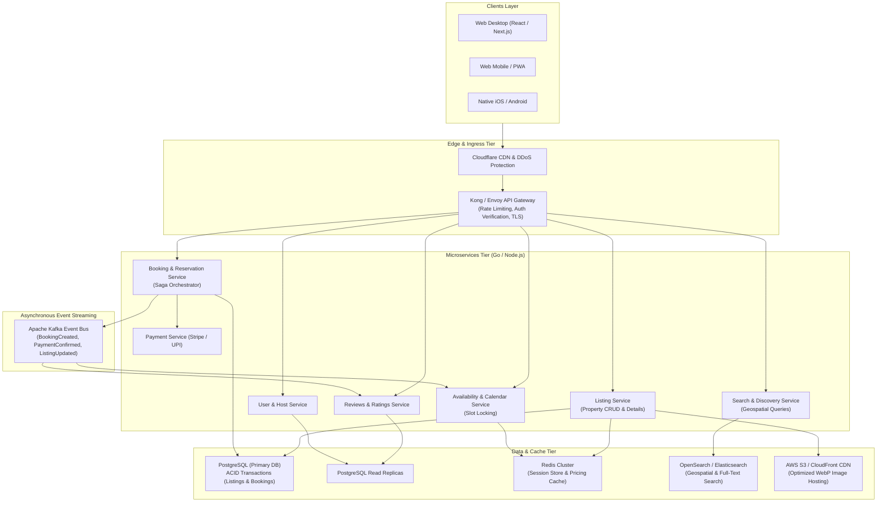

### Production Design Considerations
- **Concurrency & Double-Booking Prevention**: Distributed slot locking in Redis combined with optimistic concurrency control (`version` checks) in PostgreSQL during the reservation checkout saga.
- **Geospatial Search Engine**: OpenSearch with geo-point indexing and B-tree bounding box filters to power real-time map panning and nearby stay queries.
- **Media Optimization Pipeline**: Asynchronous media ingestion via AWS Lambda generating responsive WebP/AVIF srcsets delivered over CloudFront.

---

## 💻 Local Development Setup

### Prerequisites
- **Node.js**: v18.0.0 or higher
- **npm**: v9.0.0 or higher

### Step-by-Step Commands
```bash
# 1. Clone the repository
git clone https://github.com/Shreyans-704/Airbnb-Clone-.git

# 2. Navigate to application root
cd Airbnb-Clone-/airbnb-listing

# 3. Install dependencies
npm install

# 4. Start local development server
npm run dev
```
Open [http://localhost:5173/](http://localhost:5173/) in your browser (preferably at 1890 × 870 px viewport width for optimal desktop evaluation).

### Build & Lint Commands
```bash
# Run Oxlint (linter check across 31 source files)
npm run lint

# Build optimized production bundle
npm run build

# Preview production build locally
npm run preview
```

---

## ⚠️ Scope & Known Limitations

1. **Frontend-Only Execution**: There is no live transactional backend or SQL database. Interactions (claiming coupons, adjusting guest counts, toggling wishlists, copying URLs, and reserving dates) provide local UI feedback without mutating a persistent database.
2. **Mock Property Dataset**: Data is normalized and stored locally in [`src/data/`](airbnb-listing/src/data/) reflecting the property featured in the reference screenshots (*Romantic Jacuzzi 1BHK Candolim | Mirashya UG10*).
3. **SVG Vector Map Representation**: Rather than loading external, rate-limited Google Maps API tiles, the location section uses a self-contained SVG map of Candolim Beach to guarantee 100% offline reliability.
4. **Font Typography**: Airbnb utilizes its proprietary "Cereal" typeface. This implementation uses Google's `Inter` (`--font-family`) with tailored weights (400, 500, 600, 700, 800) as the closest open-source geometric sans-serif match.

---

## 🔮 What I Would Build Next

1. **Authentication & Session Handling**: NextAuth or Clerk integration supporting OAuth (Google, Apple) and email magic links.
2. **Live Calendar Synchronization**: Real-time availability sync via iCal / WebSockets to prevent overlapping bookings across multiple channels.
3. **End-to-End Automated Testing Suite**: Comprehensive Playwright test suite covering all interaction permutations across Chromium, Firefox, and WebKit.
4. **Live Mapping Integration**: Mapbox GL JS integration with interactive clustering, custom markers, and street-view previews.
5. **Internationalization (i18n)**: Full multi-currency and multi-language engine supporting dynamic currency conversion and locale formatting.

---

## 📋 Assignment Context

This project was built as a frontend engineering take-home assignment demonstrating:
- High visual fidelity and design system execution.
- Complex desktop UI interaction patterns (stacked modals, sticky sidebars, scroll spy).
- Rigorous accessibility (keyboard navigation, focus trapping, scroll locking).
- Modern AI-assisted engineering methodology with iterative visual QA validation.
- Architectural thinking bridging a frontend prototype to an enterprise-grade system.

---

## 👨‍💻 Author

**Shreyans Jaiswal**
- **GitHub**: [@Shreyans-704](https://github.com/Shreyans-704)
- **Repository**: [Airbnb-Clone-](https://github.com/Shreyans-704/Airbnb-Clone-)
